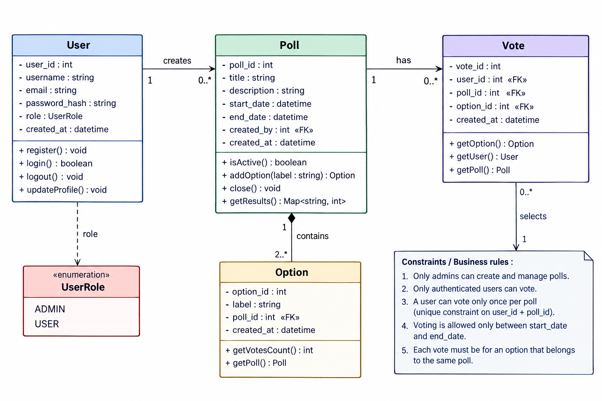

# Agora Application

Agora is a Flask-based polling application backed by MySQL. Users can register, sign in, browse polls, and vote once per poll while it is open. Administrators can create and close polls.

## Class diagram



## Features

- User registration and login with hashed passwords
- Time-bounded polls with multiple choices
- One vote per user per poll, enforced by the database
- Results shown after voting or after a poll closes
- Admin page for creating and closing polls
- CSRF protection for form submissions and a `/health` endpoint

## Requirements

- Python 3.10 or newer
- MySQL 8 or compatible
- Dependencies listed in the repository-root `requirements.txt`

## Local setup

Run these commands from the repository root. Create a MySQL database and user first, then configure the application environment variables as described below.

```sh
python -m venv .venv
. .venv/bin/activate
pip install -r requirements.txt
mysql -h "$DB_HOST" -u "$DB_USER" -p "$DB_NAME" < app/database/schema.sql
mysql -h "$DB_HOST" -u "$DB_USER" -p "$DB_NAME" < app/database/seed.sql
python app/backend/app.py
```

Set these environment variables before starting the application:

| Variable | Required | Description |
| --- | --- | --- |
| `DB_HOST` | Yes | MySQL server hostname |
| `DB_NAME` | Yes | Database name |
| `DB_USER` | Yes | MySQL username |
| `DB_PASSWORD` | Yes | MySQL password |
| `SECRET_KEY` | Yes | Long, random key used to sign Flask sessions |
| `SITE_NAME` | No | Display name; defaults to `Agora` |
| `PORT` | No | Listening port; defaults to `5000` |

An example configuration is in `backend/.env.example`. The app reads variables directly from its process environment; it does not load a `.env` file automatically. Generate a secure `SECRET_KEY` for local use, and do not use the seeded demo password in a deployed environment.

After starting, open <http://127.0.0.1:5000>. The sample database seed creates the admin account `admin` with password `AgoraDemo2026!`; change the password or remove the sample account before exposing the application beyond a local demo.

## Routes

| Route | Access | Purpose |
| --- | --- | --- |
| `/` | Public | Browse polls |
| `/health` | Public | Basic health check (`ok`) |
| `/register` | Public | Create a user account |
| `/login` | Public | Sign in |
| `/logout` | Signed in | Sign out |
| `/poll/<poll_id>` | Public | View a poll and its results when available |
| `/poll/<poll_id>/vote` | Signed in | Submit one vote while the poll is open |
| `/admin` | Admin | Manage polls |
| `/admin/polls` | Admin | Create a poll |
| `/admin/polls/<poll_id>/close` | Admin | Close a poll |

## Project layout

- `backend/app.py` — Flask routes, sessions, validation, and database access
- `backend/.env.example` — environment variable example
- `database/schema.sql` — MySQL tables and constraints
- `database/seed.sql` — sample admin account, poll, and choices
- `frontend/templates/` — Jinja templates
- `frontend/static/` — CSS assets
- `tests/` — application test suite location
